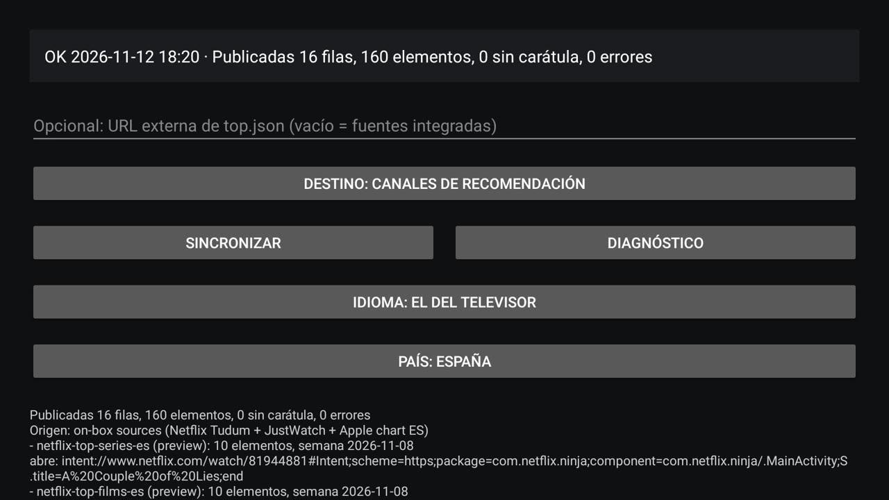

[English](README.md) · [Español](README.es.md) · [Français](README.fr.md) · Deutsch

# TV Feeder: die nationalen Toplisten auf dem TV-Startbildschirm

<p align="center"></p>

## Das Problem und was diese App dazu beiträgt

Weder Netflix noch Prime Video veröffentlichen ein Länder-Top-10 im TV Provider
von Android TV: Sie veröffentlichen *continue watching* und einen kuratierten
Vorschaukanal. `TvContract` hat keine Tabelle für ein Ranking, deshalb können der
Launcher ab Werk und Projectivy nur zeigen, was die Apps zu veröffentlichen wählen,
und eine sortierte Zeile für ein gewähltes Land kann ohne eine App, die sie
veröffentlicht, nicht existieren. Diese App verantwortet diese beiden sortierten Zeilen,
veröffentlicht sie als eigene durchsuchbare Kanäle im TV Provider und lässt
*continue watching* sowie die Zeilen aller anderen Pakete unberührt.

TV Feeder ist eine kleine Android-TV-App, die man manuell installiert. Sie baut
zwei sortierte Zeilen, **Top series** und **Top películas**, für das Land, das Sie
auf ihrem Bildschirm wählen, aus den offiziellen Quellen von Netflix und
JustWatch, veröffentlicht sie als eigene Kanäle des TV Providers und öffnet beim
Auswählen einer Karte die passende App. Sie läuft auf der Box selbst: ohne PC,
ohne Server, ohne API-Schlüssel und ohne Konto.

## Was sie veröffentlicht

| Zeile | Erzeuger der Zeile | Quelle |
|---|---|---|
| Netflix · Top series *Land* | diese App | die Netflix-Tudum-Seite Top 10 der Serien für dieses Land (`SERIES`), z. B. `netflix.com/tudum/top10/spain/tv` |
| Netflix · Top películas *Land* | diese App | die Filmseite derselben Website für dieses Land (`MOVIES`), z. B. `netflix.com/tudum/top10/spain` |
| Prime Video · Top series *Land* | diese App | beliebte Titel von JustWatch, `country: <ISO>`, im Abonnement enthaltene Angebote |
| Prime Video · Top películas *Land* | diese App | dieselbe JustWatch-Abfrage, im Abonnement enthaltene Angebote |
| Disney+ · Top series *Land* | diese App | dieselbe JustWatch-Abfrage mit dem Paket `dnp`, im Abo enthaltene Angebote |
| Disney+ · Top películas *Land* | diese App | dieselbe JustWatch-Abfrage mit dem Paket `dnp` |
| Max · Top series *Land* | diese App | dieselbe JustWatch-Abfrage mit dem Paket `mxx`, nur das Angebot von Max |
| Max · Top películas *Land* | diese App | dieselbe JustWatch-Abfrage mit dem Paket `mxx` |
| Apple TV · Top series *Land* | diese App | Apples eigener Serien-Chart „Most Popular Now" des Storefronts (`uts.col.ChartsShows.tvs.sbd.4000`) |
| Apple TV · Top películas *Land* | diese App | Apples Film-Chart desselben Storefronts (`uts.col.ChartsMovies`) |
| Movistar+ · Top series *Land* | diese App | dieselbe JustWatch-Abfrage mit dem Paket `mvs`; der Link ist `http://wl.movistarplus.es/…`, den die App über http und https annimmt |
| Movistar+ · Top películas *Land* | diese App | dieselbe JustWatch-Abfrage mit dem Paket `mvs`; der Link ist `http://wl.movistarplus.es/…`, den die App über http und https annimmt |
| SkyShowtime · Top series *Land* | diese App | dieselbe JustWatch-Abfrage mit dem Paket `sst` |
| SkyShowtime · Top películas *Land* | diese App | dieselbe JustWatch-Abfrage mit dem Paket `sst` |
| Filmin · Top series *Land* | diese App | dieselbe JustWatch-Abfrage mit dem Paket `fil`; ihre TV-App kennt nur eigene Hosts, die Karte öffnet also Filmin statt des Titels |
| Filmin · Top películas *Land* | diese App | dieselbe JustWatch-Abfrage mit dem Paket `fil`; ihre TV-App kennt nur eigene Hosts, die Karte öffnet also Filmin statt des Titels |

Jede Karte öffnet die App ihrer Plattform, wenn sie installiert ist. Derselbe Build läuft
auf Fernsehern, denen einige dieser Apps fehlen: Die Karte öffnet dann die Webseite der
Plattform im Browser des Fernsehers und bietet ohne Browser die Store-Seite der App an;
nur eine Karte ohne jedes Ziel entfällt, und der Sync-Bericht zählt sie. Die Apple-Zeilen
sind Apples eigener Store-Chart und können daher auch Kauf- und Leih-Titel enthalten.

Immer nur ein Land, und sein Name steht im Titel der Zeile, in der Sprache des
Bildschirms: mit Deutschland lesen sich die Zeilen **Netflix · Top series Alemania**
auf einem spanischen Bildschirm und **Netflix · Top series Germany** auf einem
englischen. Die Kanal-Ids tragen den Ländercode (`netflix-top-series-de`,
`prime-top-films-de`), zwei Länder teilen sich also nie eine Zeile. Diese Anleitung
verwendet für ihre Beispiele Spanien (`netflix-top-series-es`).

*Seguir viendo* bleibt unangetastet: Diese Zeile veröffentlichen Netflix und
Prime Video selbst. Das Dokument entsteht aus den zwei Tudum-Seiten des gewählten
Landes und den zwei JustWatch-Abfragen dafür, nie aus dem weltweiten Wochendatensatz
von Netflix mit 33 MB, den keine TV-Box herunterladen sollte.

Jede Karte wird vor der Veröffentlichung auf dem Gerät aufgelöst, sodass ein
Auswählen Netflix oder Prime Video öffnet statt eines toten Links. Eine Karte,
deren Link sich nicht auflösen lässt, wird nicht veröffentlicht, und der
Synchronisationsbericht zählt sie.

Die Prime-Video-Karten verwenden ein Querformat-Standbild von JustWatch (480 px)
als Kartenbild und das Hochformat-Poster (592 px) als Poster, weil ein 2:3-Poster in
die 16:9-Karte gestreckt wurde; ein Titel ohne Standbild verwendet sein Poster. Die
Netflix-Karten ändern sich nicht. Amazon veröffentlicht kein sortiertes
Prime-Video-Top-10 pro Land, das anonym lesbar wäre, deshalb bleibt JustWatch die
Prime-Quelle: [feeder.de.md](docs/feeder.de.md) hält fest, was geprüft wurde.

## So sieht es aus


*Projectivy zeigt die Reihe **Prime Video · Top series** über den Netflix-Reihen: die App hat Rangliste, Artwork und Ziel jeder Karte veröffentlicht.*


*Eine Synchronisierung auf der Box: vier Reihen, vierzig Karten, das Land in jedem Zeilentitel, und der Bildschirm in der Sprache des Fernsehers.*




*Sechzehn Zeilen und 160 Karten auf einem Fernseher ohne eine dieser Apps: Jede Karte öffnet
die Webseite der Plattform im Browser oder die Store-Seite der App.*

## Voraussetzungen

| Punkt | Detail |
|---|---|
| Gerät | eine Android-TV- oder Google-TV-Box, zum Beispiel eine Mi Box S, mit **Android 9 (API 28) oder neuer** |
| Apps | **Netflix** und **Prime Video** installiert, damit die Karten etwas zu öffnen haben |
| Berechtigung | `READ_TV_LISTINGS`, zur Laufzeit erteilt im Dialog der ersten Synchronisation |
| Netzwerk | HTTPS-Zugriff auf `www.netflix.com` und `apis.justwatch.com` |

## Bauen und manuell installieren

```bash
bash tools/build-apk.sh                                  # app/build/toptv-feeder.apk
adb install -r app/build/toptv-feeder.apk
adb shell am start -n com.alberto.tvfeeder/.MainActivity
```

Lassen Sie danach das URL-Feld **leer**, drücken Sie auf **Sync** und bestätigen
Sie den Dialog für die TV-Listings. Die Zeilen erscheinen im Launcher, der den TV
Provider liest; in Projectivy müssen zuerst dessen eigene Kanäle aktiviert werden.

Ohne ADB kopieren Sie `app/build/toptv-feeder.apk` auf einen USB-Stick, erlauben
unbekannte Quellen für den Dateimanager des Fernsehers und installieren die App
von dort.

Das Dokument wird in `files/last_good-<cc>.json` im privaten Datenverzeichnis der App
zwischengespeichert, sodass eine fehlgeschlagene Aktualisierung die bereits
sichtbaren Zeilen stehen lässt.

Schrittweise Einrichtung auf einem echten Gerät, mit Screenshots: [install.de.md](docs/install.de.md).

## Wann synchronisiert wird

| Auslöser | Zeitpunkt |
|---|---|
| Start | beim Hochfahren der Box, sobald das Netzwerk steht |
| täglich | alle 24 Stunden, in jedem Netzwerk |
| manuell | wenn Sie in der Activity auf **Sync** drücken |

Eine Aktualisierung endet nicht mehr bei der ersten fehlschlagenden Quelle: Eine
Quelle, die fehlschlägt oder leer zurückkommt, wird im Bericht genannt, und die
anderen Zeilen werden trotzdem veröffentlicht. Ein Land, in dem JustWatch dünn ist,
kann also nur die Netflix-Zeilen veröffentlichen. Wenn gar nichts veröffentlicht
werden kann, bleiben die Zeilen im Launcher unverändert.

## Ziel

Die Schaltfläche **Destination** in der Activity wechselt die Tabelle, in die die
Zeilen veröffentlicht werden, und synchronisiert sofort:

- **Destination: recommendation channels** (Standard) veröffentlicht
  Vorschaukanäle und Vorschauprogramme, die übliche Empfehlungsfläche.
- **Destination: Watch Next** veröffentlicht in Watch Next, neben *Seguir viendo*,
  für Launcher, die Vorschaukanäle ignorieren.

## Sprache

Der Bildschirm folgt der Sprache des Fernsehers, und die Schaltfläche **Language**
in der Activity schaltet sie weiter: die des Fernsehers → English → Español
(`Idioma`, sobald der Bildschirm spanisch ist). Die Wahl wird gespeichert und
übersteht Neustarts, und der Synchronisationsbericht wird in der Sprache
geschrieben, die der Bildschirm hat, wenn die Synchronisation läuft. Ausgeliefert
werden nur Englisch und Spanisch, ein Fernseher in jeder anderen Sprache bekommt
also Englisch.

## Land

Die App sammelt die Ranglisten **eines Landes**, das auf ihrem Bildschirm gewählt
wird. Sie startet mit dem Land des TV-Locales, wenn die App es unterstützt, und
sonst mit Spanien. Die Schaltfläche **Land** (`Country` auf einem englischen
Bildschirm) zeigt die aktuelle Wahl, etwa `Land: Spanien`, und öffnet die Liste der
unterstützten Länder:

Spanien (ES), Deutschland (DE), Niederlande (NL), Frankreich (FR), Italien (IT),
Vereinigtes Königreich (GB), Vereinigte Staaten (US), Portugal (PT), Belgien (BE),
Österreich (AT), Schweiz (CH), Schweden (SE), Polen (PL), Irland (IE), Mexiko (MX),
Brasilien (BR) und Argentinien (AR).

Die Wahl wird wie die Sprache gespeichert und übersteht Neustarts, und die
Zeilentitel tragen den Ländernamen in der Sprache des Bildschirms. Ein Wechsel des
Landes oder der Sprache löscht die älteren Zeilen dieser App, der Launcher behält
also keine leeren Zeilen des vorherigen Landes.

## Prüfung

Die Prüfungen laufen offline: nur Fixtures, ohne Netzwerk und ohne Fernseher.

```bash
python3 tests/test_docs.py          # four languages present, interlinked and in sync
```

## Dokumentation und Lizenz

[feeder.md](docs/feeder.md) ist die vollständige Anleitung: Quellen, Dokumentformat,
autonomer Betrieb, Auflösung der Karten, Diagnose auf der Box und bekannte
Grenzen. Das Projekt steht unter der [MIT-Lizenz](LICENSE).