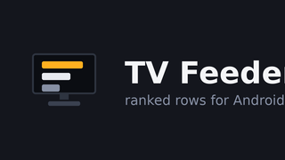
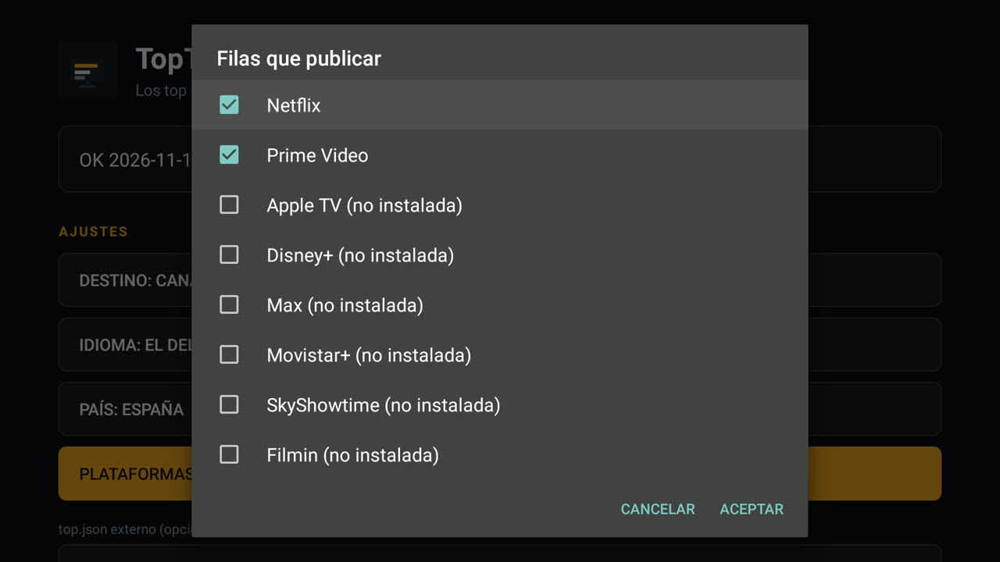

[English](README.md) · Español · [Français](README.fr.md) · [Deutsch](README.de.md)

# TV Feeder: los top nacionales en la pantalla de inicio del televisor

<p align="center"></p>

## El problema y lo que resuelve esta app

Ni Netflix ni Prime Video publican un Top 10 por país en el TV Provider de Android
TV: publican *seguir viendo* y un canal de vista previa curado. `TvContract` no
tiene ninguna tabla para un ranking, así que el lanzador de fábrica y Projectivy
solo pueden mostrar lo que las apps deciden publicar, y una fila de ranking de un
país elegido no puede existir sin una app que la publique. Esta app es dueña de esas dos
filas de ranking, las publica en el TV Provider como canales propios y
consultables, y deja intactos *seguir viendo* y las filas de cualquier otro
paquete.

TV Feeder es una pequeña aplicación de Android TV que se instala manualmente.
Construye dos filas de ranking, **Top series** y **Top películas**, para el país
que elijas en su pantalla, con las fuentes oficiales de Netflix y JustWatch, las
publica como canales propios del TV Provider y abre la aplicación correspondiente
cuando se pulsa una tarjeta. Se ejecuta en la propia caja: sin PC, sin servidor,
sin clave de API y sin cuenta.

## Qué publica

| Fila | Productor de la fila | Fuente |
|---|---|---|
| Netflix · Top series *país* | esta aplicación | la página Top 10 de series de Netflix Tudum para ese país (`SERIES`), p. ej. `netflix.com/tudum/top10/spain/tv` |
| Netflix · Top películas *país* | esta aplicación | la página de películas del mismo sitio para ese país (`MOVIES`), p. ej. `netflix.com/tudum/top10/spain` |
| Prime Video · Top series *país* | esta aplicación | títulos populares de JustWatch, `country: <ISO>`, ofertas incluidas en la suscripción |
| Prime Video · Top películas *país* | esta aplicación | la misma consulta a JustWatch, ofertas incluidas en la suscripción |
| Disney+ · Top series *país* | esta aplicación | la misma consulta a JustWatch con el paquete `dnp`, ofertas incluidas en la suscripción |
| Disney+ · Top películas *país* | esta aplicación | la misma consulta a JustWatch con el paquete `dnp` |
| Max · Top series *país* | esta aplicación | la misma consulta a JustWatch con el paquete `mxx`, conservando solo la oferta que es de Max |
| Max · Top películas *país* | esta aplicación | la misma consulta a JustWatch con el paquete `mxx` |
| Apple TV · Top series *país* | esta aplicación | el ranking de series «Lo más popular ahora mismo» de la tienda Apple de ese país (`uts.col.ChartsShows.tvs.sbd.4000`) |
| Apple TV · Top películas *país* | esta aplicación | el ranking de películas de la tienda Apple de ese país (`uts.col.ChartsMovies`) |
| Movistar+ · Top series *país* | esta aplicación | la misma consulta a JustWatch con el paquete `mvs`; su enlace es `http://wl.movistarplus.es/…`, que la app registra en http y https |
| Movistar+ · Top películas *país* | esta aplicación | la misma consulta a JustWatch con el paquete `mvs`; su enlace es `http://wl.movistarplus.es/…`, que la app registra en http y https |
| SkyShowtime · Top series *país* | esta aplicación | la misma consulta a JustWatch con el paquete `sst` |
| SkyShowtime · Top películas *país* | esta aplicación | la misma consulta a JustWatch con el paquete `sst` |
| Filmin · Top series *país* | esta aplicación | la misma consulta a JustWatch con el paquete `fil`; su app de TV solo declara sus propios hosts, así que esta tarjeta abre Filmin y no el título |
| Filmin · Top películas *país* | esta aplicación | la misma consulta a JustWatch con el paquete `fil`; su app de TV solo declara sus propios hosts, así que esta tarjeta abre Filmin y no el título |

Una fila solo existe en el televisor que tiene la app de esa plataforma: con Netflix y
Prime Video instalados tienes sus cuatro filas, y una plataforma que no usas no se publica
nunca, así que el lanzador no carga filas que no puedas abrir. Cada tarjeta abre la app de su
plataforma. Si quitas una app, la siguiente sincronización borra sus filas y dice cuántas.
Las filas de Apple son el ranking de la propia tienda, así que pueden incluir títulos de
compra o alquiler.

Se recoge un solo país a la vez, y su nombre va en el título de la fila, en el
idioma de la pantalla: con Alemania seleccionada las filas dicen **Netflix · Top
series Alemania** en una pantalla en español y **Netflix · Top series Germany** en
una en inglés. Los identificadores de canal llevan el código del país
(`netflix-top-series-de`, `prime-top-films-de`), así que dos países nunca comparten
una fila. Esta guía usa España en sus ejemplos (`netflix-top-series-es`).

*Seguir viendo* no se toca: esa fila la publican Netflix y Prime Video por su
cuenta. El documento se construye a partir de las dos páginas de Tudum del país
elegido y de las dos consultas a JustWatch para ese país, nunca a partir del
conjunto de datos semanal mundial de Netflix de 33 MB, que ninguna caja de TV
debería tener que descargar.

Cada tarjeta se resuelve en el dispositivo antes de publicarse, así que al pulsarla
se abre Netflix o Prime Video en lugar de un enlace muerto. Una tarjeta cuyo
enlace no resuelve no se publica, y el informe de sincronización la cuenta.

Las tarjetas de Prime Video usan una imagen de fondo apaisada de JustWatch (480 px)
como imagen de la tarjeta y el póster vertical (592 px) como carátula, porque un
póster 2:3 se estiraba dentro de la tarjeta 16:9; un título sin imagen de fondo usa
su póster. Las tarjetas de Netflix no cambian. Amazon no publica ningún Top 10 de
Prime Video ordenado y por país que se pueda leer de forma anónima, así que
JustWatch sigue siendo la fuente de Prime: [feeder.es.md](docs/feeder.es.md) recoge lo
que se comprobó.

## Cómo se ve


*Projectivy mostrando la fila **Prime Video · Top series** sobre las de Netflix: la app publicó el ranking, las carátulas y el destino de cada tarjeta.*


*Una sincronización en la caja: cuatro filas, cuarenta tarjetas, el país en el título de cada fila y la pantalla en el idioma del televisor.*

## Requisitos

| Elemento | Detalle |
|---|---|
| Dispositivo | una caja Android TV o Google TV, por ejemplo una Mi Box S, con **Android 9 (API 28) o posterior** |
| Aplicaciones | **Netflix** y **Prime Video** instaladas, para que las tarjetas tengan algo que abrir |
| Permiso | `READ_TV_LISTINGS`, concedido en tiempo de ejecución en el diálogo que muestra la primera sincronización |
| Red | acceso HTTPS a `www.netflix.com` y `apis.justwatch.com` |

## Compilar e instalar manualmente

```bash
bash tools/build-apk.sh                                  # app/build/toptv-feeder.apk
adb install -r app/build/toptv-feeder.apk
adb shell am start -n com.alberto.tvfeeder/.MainActivity
```

Después deja el campo de URL **vacío**, pulsa **Sync** y acepta el diálogo de
listados de TV. Las filas aparecen en el lanzador que lee el TV Provider; en
Projectivy hay que habilitar antes sus propios canales.

Sin ADB, copia `app/build/toptv-feeder.apk` a un lápiz USB, permite orígenes
desconocidos para el gestor de archivos del televisor e instálala desde ahí.

El documento se guarda en caché en `files/last_good-<cc>.json`, dentro del directorio
privado de datos de la aplicación, de modo que una actualización fallida deja
intactas las filas que ya ves.

Instalación paso a paso en un dispositivo real, con capturas: [install.es.md](docs/install.es.md).

## Cuándo sincroniza

| Disparador | Momento |
|---|---|
| arranque | al encender la caja, cuando la red está disponible |
| diario | cada 24 horas, con cualquier red |
| manual | al pulsar **Sync** en la actividad |

Una actualización ya no se detiene en la primera fuente que falla: una fuente que
falla o vuelve vacía se nombra en el informe y las demás filas se publican
igualmente, así que un país donde JustWatch tiene poco puede publicar solo las
filas de Netflix. Cuando no se puede publicar nada, las filas que ya están en el
lanzador se quedan intactas.

## Destino de las filas

El botón **Destination** de la actividad cambia la tabla de destino de las filas y
sincroniza al instante:

- **Destination: recommendation channels** (por defecto) publica canales de vista
  previa y programas de vista previa, la superficie de recomendaciones habitual.
- **Destination: Watch Next** publica en Watch Next, junto a *Seguir viendo*, para
  los lanzadores que ignoran los canales de vista previa.

## Idioma

La pantalla sigue el idioma del propio televisor, y el botón **Idioma** de la
actividad (`Language` con la pantalla en inglés) lo va cambiando: el del televisor
→ English → Español. La elección se guarda y sobrevive a los reinicios, y el
informe de sincronización se escribe en el idioma que tiene la pantalla cuando corre
la sincronización. Solo se publican inglés y español, así que un televisor en
cualquier otro idioma recibe inglés.

## Plataformas

El botón **Plataformas** lista todos los servicios admitidos con una casilla y dice cuántas
hay marcadas. La primera vez solo están marcadas las apps instaladas en ese televisor, así
que una casa que usa Netflix y Prime Video recibe exactamente sus cuatro filas y nada más.
Marca otro servicio cuando su app esté aquí y sus filas aparecerán en la siguiente
sincronización; las filas del servicio que desmarques se borran por obsoletas. Un servicio
marcado cuya app no está se muestra como *(no instalada)* y no publica nada, porque no habría
app que abrir.



*Plataformas: ocho servicios, los dos instalados ya marcados y el resto indicado como no instalado.*

## País

La app recoge los rankings de **un solo país**, que se elige en su pantalla. Arranca
con el país de la configuración regional del propio televisor cuando la app lo
admite, y con España en caso contrario. El botón **País** (`Country` con la pantalla
en inglés) muestra la elección actual, `País: España`, y abre la lista de países
admitidos:

España (ES), Alemania (DE), Países Bajos (NL), Francia (FR), Italia (IT), Reino
Unido (GB), Estados Unidos (US), Portugal (PT), Bélgica (BE), Austria (AT), Suiza
(CH), Suecia (SE), Polonia (PL), Irlanda (IE), México (MX), Brasil (BR) y Argentina
(AR).

La elección se guarda como el idioma y sobrevive a los reinicios, y los títulos de
las filas llevan el nombre del país en el idioma de la pantalla. Cambiar de país o
de idioma borra las filas anteriores de esta app, así que el lanzador no se queda
con filas vacías del país anterior.

## Verificación

Las comprobaciones son sin conexión: solo fixtures, no hace falta red ni
televisor.

```bash
python3 tests/test_docs.py          # four languages present, interlinked and in sync
```

## Documentación y licencia

[feeder.md](docs/feeder.md) es la guía completa: fuentes, formato del documento, modo
autónomo, resolución de tarjetas, diagnóstico en la caja y los límites conocidos.
El proyecto tiene [licencia MIT](LICENSE).