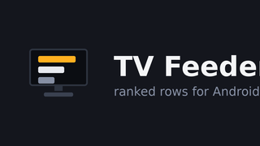
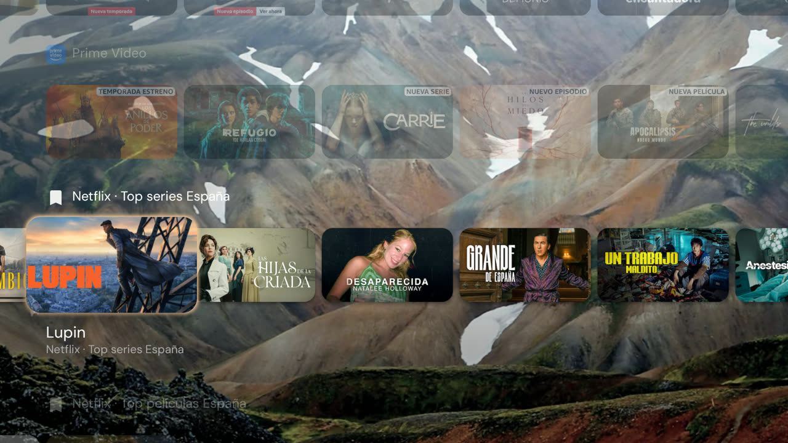
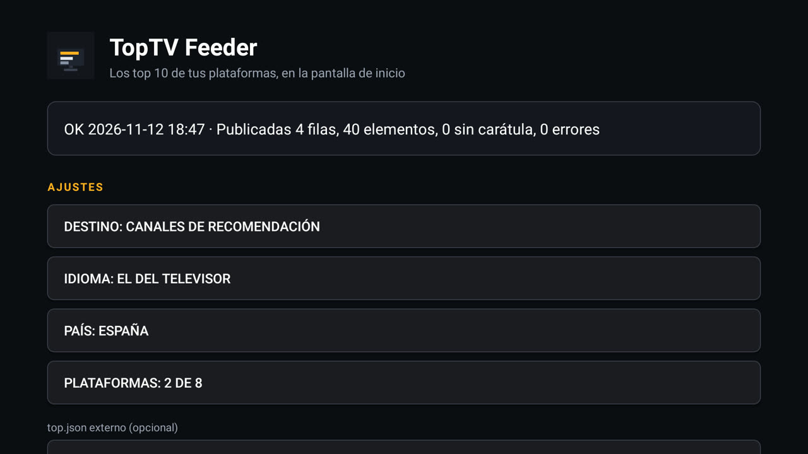
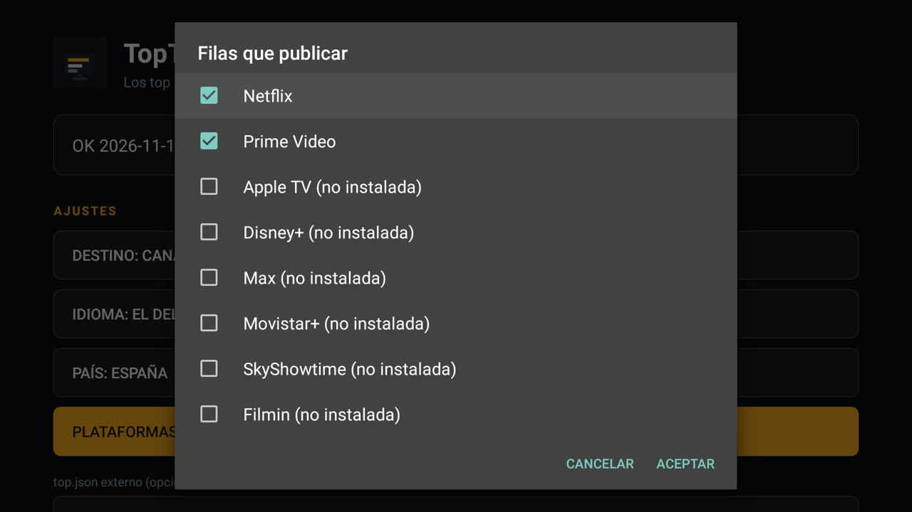

[English](README.md) · [Español](README.es.md) · Français · [Deutsch](README.de.md)

# TV Feeder : les tops nationaux sur l'écran d'accueil du téléviseur

<p align="center"></p>

## Le problème, et ce que cette application y apporte

Ni Netflix ni Prime Video ne publient de Top 10 par pays dans le TV Provider
Android TV : ils publient *continue watching* et une chaîne d'aperçu
éditorialisée. `TvContract` n'a aucune table pour un classement, donc le lanceur
d'origine et Projectivy ne peuvent afficher que ce que les applications choisissent
de publier, et une rangée de classement pour un pays choisi ne peut pas exister sans
une application qui la publie. Cette application prend en charge ces deux rangées
classées, les publie dans le TV Provider comme ses propres chaînes interrogeables,
et laisse intactes *continue watching* ainsi que les rangées de tous les autres
paquets.

TV Feeder est une petite application Android TV à installer manuellement. Elle
construit deux rangées classées, **Top series** et **Top películas**, pour le pays
choisi sur son écran, à partir des sources officielles de Netflix et de JustWatch,
les publie comme ses propres chaînes du TV Provider et ouvre l'application
correspondante lorsqu'une carte est sélectionnée. Elle fonctionne sur le boîtier
lui-même : sans PC, sans serveur, sans clé d'API et sans compte.

## Ce qu'elle publie

| Rangée | Producteur de la rangée | Source |
|---|---|---|
| Netflix · Top series *pays* | cette application | la page Top 10 des séries de Netflix Tudum pour ce pays (`SERIES`), p. ex. `netflix.com/tudum/top10/spain/tv` |
| Netflix · Top películas *pays* | cette application | la page des films du même site pour ce pays (`MOVIES`), p. ex. `netflix.com/tudum/top10/spain` |
| Prime Video · Top series *pays* | cette application | les titres populaires de JustWatch, `country: <ISO>`, offres comprises dans l'abonnement |
| Prime Video · Top películas *pays* | cette application | la même requête JustWatch, offres comprises dans l'abonnement |
| Disney+ · Top series *pays* | cette application | la même requête JustWatch avec le paquet `dnp`, offres comprises dans l'abonnement |
| Disney+ · Top películas *pays* | cette application | la même requête JustWatch avec le paquet `dnp` |
| Max · Top series *pays* | cette application | la même requête JustWatch avec le paquet `mxx`, en ne gardant que l'offre de Max |
| Max · Top películas *pays* | cette application | la même requête JustWatch avec le paquet `mxx` |
| Apple TV · Top series *pays* | cette application | le classement des séries « Le plus populaire » de la boutique Apple du pays (`uts.col.ChartsShows.tvs.sbd.4000`) |
| Apple TV · Top películas *pays* | cette application | le classement des films de la boutique Apple du pays (`uts.col.ChartsMovies`) |
| Movistar+ · Top series *pays* | cette application | la même requête JustWatch avec le paquet `mvs` ; son lien est `http://wl.movistarplus.es/…`, que l'application déclare en http et https |
| Movistar+ · Top películas *pays* | cette application | la même requête JustWatch avec le paquet `mvs` ; son lien est `http://wl.movistarplus.es/…`, que l'application déclare en http et https |
| SkyShowtime · Top series *pays* | cette application | la même requête JustWatch avec le paquet `sst` |
| SkyShowtime · Top películas *pays* | cette application | la même requête JustWatch avec le paquet `sst` |
| Filmin · Top series *pays* | cette application | la même requête JustWatch avec le paquet `fil` ; son application TV ne déclare que ses propres hôtes, la carte ouvre donc Filmin et non le titre |
| Filmin · Top películas *pays* | cette application | la même requête JustWatch avec le paquet `fil` ; son application TV ne déclare que ses propres hôtes, la carte ouvre donc Filmin et non le titre |

Une ligne n'existe que sur le téléviseur qui possède l'application de la plateforme : avec
Netflix et Prime Video installés, vous avez leurs quatre lignes, et une plateforme que vous
n'utilisez pas n'est jamais publiée, donc le lanceur ne porte aucune ligne que vous ne
puissiez ouvrir. Chaque carte ouvre l'application de sa plateforme. Si vous retirez une
application, la synchronisation suivante supprime ses lignes et dit combien. Les lignes
Apple viennent du classement de la boutique Apple : elles peuvent donc inclure des titres à
acheter ou à louer.

Un seul pays à la fois, et son nom figure dans le titre de la rangée, dans la langue
de l'écran : avec l'Allemagne sélectionnée, les rangées affichent **Netflix · Top
series Alemania** sur un écran espagnol et **Netflix · Top series Germany** sur un
écran anglais. Les identifiants de chaîne portent le code du pays
(`netflix-top-series-de`, `prime-top-films-de`), donc deux pays ne partagent jamais
une rangée. Ce guide prend l'Espagne pour ses exemples (`netflix-top-series-es`).

*Seguir viendo* n'est pas touchée : Netflix et Prime Video publient eux-mêmes cette
rangée. Le document est construit à partir des deux pages Tudum du pays choisi et
des deux requêtes JustWatch pour ce pays, jamais à partir du jeu de données
hebdomadaire mondial de Netflix de 33 Mo, qu'aucun boîtier TV ne devrait avoir à
télécharger.

Chaque carte est résolue sur l'appareil avant d'être publiée : une sélection ouvre
donc Netflix ou Prime Video au lieu d'un lien mort. Une carte dont le lien ne se
résout pas n'est pas publiée, et le rapport de synchronisation la compte.

Les cartes Prime Video utilisent une image fixe en paysage de JustWatch (480 px)
comme image de carte et l'affiche en portrait (592 px) comme affiche, car une
affiche 2:3 était étirée dans la carte 16:9 ; un titre sans image de fond utilise
son affiche. Les cartes Netflix ne changent pas. Amazon ne publie aucun Top 10 Prime
Video ordonné et par pays qui puisse être lu de façon anonyme, donc JustWatch reste
la source Prime : [feeder.fr.md](docs/feeder.fr.md) détaille ce qui a été vérifié.

## À quoi cela ressemble



*Projectivy affichant la rangée **Prime Video · Top series** au-dessus de celles de Netflix : l'app a publié le classement, les visuels et la cible de chaque carte.*



*Une synchronisation sur le boîtier : quatre rangées, quarante cartes, le pays dans le titre de chaque rangée, et l'écran dans la langue du téléviseur.*

## Prérequis

| Élément | Détail |
|---|---|
| Appareil | un boîtier Android TV ou Google TV, par exemple un Mi Box S, sous **Android 9 (API 28) ou plus récent** |
| Applications | **Netflix** et **Prime Video** installées, pour que les cartes aient une application à ouvrir |
| Autorisation | `READ_TV_LISTINGS`, accordée à l'exécution dans la boîte de dialogue de la première synchronisation |
| Réseau | accès HTTPS à `www.netflix.com` et `apis.justwatch.com` |

## Compiler et installer manuellement

```bash
bash tools/build-apk.sh                                  # app/build/toptv-feeder.apk
adb install -r app/build/toptv-feeder.apk
adb shell am start -n com.alberto.tvfeeder/.MainActivity
```

Laissez ensuite le champ URL **vide**, appuyez sur **Sync** et acceptez la boîte
de dialogue des listes TV. Les rangées apparaissent dans le lanceur qui lit le TV
Provider ; dans Projectivy, il faut d'abord activer ses propres chaînes.

Sans ADB, copiez `app/build/toptv-feeder.apk` sur une clé USB, autorisez les sources
inconnues pour le gestionnaire de fichiers du téléviseur et installez-la depuis
cette clé.

Le document est mis en cache dans `files/last_good-<cc>.json`, dans le répertoire de
données privé de l'application : une actualisation qui échoue laisse donc en place
les rangées que vous voyez déjà.

Installation pas à pas sur un appareil réel, avec captures : [install.fr.md](docs/install.fr.md).

## Quand la synchronisation a lieu

| Déclencheur | Moment |
|---|---|
| démarrage | au démarrage du boîtier, dès que le réseau est disponible |
| quotidien | toutes les 24 heures, sur n'importe quel réseau |
| manuel | lorsque vous appuyez sur **Sync** dans l'activité |

Une actualisation ne s'arrête plus à la première source en échec : une source qui
échoue ou revient vide est nommée dans le rapport et les autres rangées sont
publiées quand même, donc un pays où JustWatch est maigre peut ne publier que les
rangées Netflix. Quand rien ne peut être publié, les rangées déjà présentes dans le
lanceur restent intactes.

## Destination

Le bouton **Destination** de l'activité change la table vers laquelle les rangées
sont publiées et synchronise immédiatement :

- **Destination: recommendation channels** (par défaut) publie des chaînes d'aperçu
  et des programmes d'aperçu, la surface de recommandations habituelle.
- **Destination: Watch Next** publie dans Watch Next, à côté de *Seguir viendo*,
  pour les lanceurs qui ignorent les chaînes d'aperçu.

## Langue

L'écran suit la langue du téléviseur, et le bouton **Language** de l'activité la
fait tourner : celle du téléviseur → English → Español (`Idioma` une fois l'écran en
espagnol). Le choix est enregistré et survit aux redémarrages, et le rapport de
synchronisation est écrit dans la langue de l'écran au moment où la synchronisation
s'exécute. Seuls l'anglais et l'espagnol sont livrés, donc un téléviseur dans toute
autre langue reçoit l'anglais.

## Plateformes

Le bouton **Plateformes** liste tous les services pris en charge avec une case à cocher et
indique combien sont cochés. Au premier lancement, seules les applications installées sur ce
téléviseur sont cochées : un foyer qui utilise Netflix et Prime Video obtient exactement leurs
quatre lignes et rien d'autre. Cochez un autre service une fois son application présente et
ses lignes apparaîtront à la synchronisation suivante ; les lignes d'un service décoché sont
supprimées comme obsolètes. Un service coché dont l'application manque est affiché
*(non installée)* et ne publie rien, faute d'application à ouvrir.



*Plateformes : huit services, les deux installés déjà cochés, les autres indiqués comme non installés.*

## Pays

L'application récupère les classements d'**un seul pays**, choisi sur son écran. Elle
démarre avec le pays de la locale du téléviseur lorsque l'application le prend en
charge, et avec l'Espagne sinon. Le bouton **Pays** (`Country` sur un écran anglais)
affiche le choix courant, `Pays : Allemagne`, et ouvre la liste des pays pris en
charge :

Espagne (ES), Allemagne (DE), Pays-Bas (NL), France (FR), Italie (IT), Royaume-Uni
(GB), États-Unis (US), Portugal (PT), Belgique (BE), Autriche (AT), Suisse (CH),
Suède (SE), Pologne (PL), Irlande (IE), Mexique (MX), Brésil (BR) et Argentine (AR).

Le choix est enregistré comme la langue et survit aux redémarrages, et les titres des
rangées portent le nom du pays dans la langue de l'écran. Changer de pays ou de
langue supprime les anciennes rangées de cette application, donc le lanceur ne
conserve pas de rangées vides du pays précédent.

## Vérification

Les contrôles sont hors ligne : uniquement des fixtures, sans réseau et sans
téléviseur.

```bash
python3 tests/test_docs.py          # four languages present, interlinked and in sync
```

## Documentation et licence

[feeder.md](docs/feeder.md) est le guide complet : sources, format du document, mode
autonome, résolution des cartes, diagnostic sur le boîtier et limites connues. Le
projet est sous [licence MIT](LICENSE).