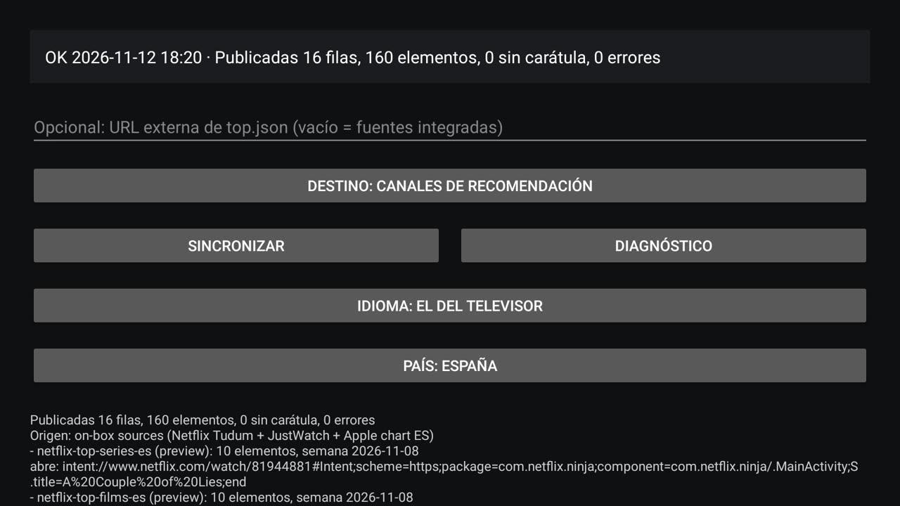

English · [Español](README.es.md) · [Français](README.fr.md) · [Deutsch](README.de.md)

# TV Feeder: national top tens on the TV home screen

<p align="center"></p>

## The problem, and what this app does about it

Neither Netflix nor Prime Video publishes a per-country Top 10 to the Android TV
Provider: they publish continue-watching and one curated preview channel.
`TvContract` has no table for a ranking, so the stock launcher and Projectivy can
only show what the apps choose to publish, and a ranked row for a chosen country
cannot exist without an app that publishes it. This app owns those two ranked rows,
publishes them into the TV Provider as its own searchable channels, and leaves
continue-watching and every other package's rows untouched.

TV Feeder is a small sideloaded Android TV app. It builds two ranked rows,
**Top series** and **Top películas**, for the country you select on its screen,
from the official Netflix and JustWatch sources, publishes them as its own TV
Provider channels, and opens the matching app when a card is tapped. It runs on
the box itself: no PC, no server, no API key and no account.

## What it publishes

| Row | Row producer | Source |
|---|---|---|
| Netflix · Top series *country* | this app | the Netflix Tudum Top 10 series page of that country (`SERIES`), e.g. `netflix.com/tudum/top10/spain/tv` |
| Netflix · Top películas *country* | this app | the same site's film page of that country (`MOVIES`), e.g. `netflix.com/tudum/top10/spain` |
| Prime Video · Top series *country* | this app | JustWatch popular titles, `country: <ISO code>`, offers included with the subscription |
| Prime Video · Top películas *country* | this app | the same JustWatch query, offers included with the subscription |
| Disney+ · Top series *country* | this app | the same JustWatch query with the `dnp` package, offers included with the subscription |
| Disney+ · Top películas *country* | this app | the same JustWatch query with the `dnp` package |
| Max · Top series *country* | this app | the same JustWatch query with the `mxx` package, keeping only the offer that belongs to Max |
| Max · Top películas *country* | this app | the same JustWatch query with the `mxx` package |
| Apple TV · Top series *country* | this app | Apple's own "Most Popular Now" series chart of that storefront (`uts.col.ChartsShows.tvs.sbd.4000`) |
| Apple TV · Top películas *country* | this app | Apple's own film chart of that storefront (`uts.col.ChartsMovies`) |
| Movistar+ · Top series *country* | this app | the same JustWatch query with the `mvs` package; its link is `http://wl.movistarplus.es/…`, which the app registers over http and https |
| Movistar+ · Top películas *country* | this app | the same JustWatch query with the `mvs` package; its link is `http://wl.movistarplus.es/…`, which the app registers over http and https |
| SkyShowtime · Top series *country* | this app | the same JustWatch query with the `sst` package |
| SkyShowtime · Top películas *country* | this app | the same JustWatch query with the `sst` package |
| Filmin · Top series *country* | this app | the same JustWatch query with the `fil` package; its TV app only claims its own hosts, so this card opens Filmin rather than the title |
| Filmin · Top películas *country* | this app | the same JustWatch query with the `fil` package; its TV app only claims its own hosts, so this card opens Filmin rather than the title |

Every card opens its platform's app when that app is installed. The same build runs on
TVs that lack some of these apps, so a card then opens the platform's web page in the
television's browser, and when there is no browser it offers the app's store page; only a
card with no destination at all is dropped, and the sync report counts it. The Apple rows
are Apple's own store chart, so they can include titles sold rather than streamed.

One country at a time, and its name is in the row title, in the language of the
screen: with Germany selected the rows read **Netflix · Top series Alemania** on a
Spanish screen and **Netflix · Top series Germany** on an English one. The channel
ids carry the country code (`netflix-top-series-de`, `prime-top-films-de`), so two
countries never share a row. This guide uses Spain for its examples
(`netflix-top-series-es`).

*Seguir viendo* is untouched: Netflix and Prime Video publish that row
themselves. The document is built from the two Tudum pages of the selected country
plus the two JustWatch queries for it, never from Netflix's 33 MB world-wide weekly
dataset, which no TV box should have to download.

Each card is resolved on the device before it is published, so a tap opens
Netflix or Prime Video instead of a dead link. A card whose link resolves to
nothing is not published, and the sync report counts it.

The Prime Video cards use a JustWatch landscape still (480 px) as the card image and
the portrait poster (592 px) as poster art, because a 2:3 poster was being stretched
into the 16:9 card; a title with no backdrop falls back to its poster. The Netflix
cards are unchanged. Amazon publishes no ordered per-country Prime Video Top 10 that
can be read anonymously, so JustWatch stays the Prime source: [feeder.md](docs/feeder.md)
records what was checked.

## What it looks like


*Projectivy drawing the **Prime Video · Top series** row over the Netflix rows: the app published the ranking, the artwork and the tap target.*


*One sync on the box: four rows, forty cards, the country in every row title, and the screen in the TV's own language.*




*Sixteen rows and 160 cards on a TV that has none of the extra platform apps: each card opens
the platform's web page in the browser, or the app's store page.*

## Requirements

| Item | Detail |
|---|---|
| Device | an Android TV or Google TV box, e.g. a Mi Box S, on **Android 9 (API 28) or later** |
| Apps | **Netflix** and **Prime Video** installed, so the cards have something to open |
| Permission | `READ_TV_LISTINGS`, granted at runtime in the dialog the first sync shows |
| Network | HTTPS access to `www.netflix.com` and `apis.justwatch.com` |

## Build and sideload

```bash
bash tools/build-apk.sh                                  # app/build/toptv-feeder.apk
adb install -r app/build/toptv-feeder.apk
adb shell am start -n com.alberto.tvfeeder/.MainActivity
```

Then leave the URL field **empty**, press **Sync** and accept the TV listings
dialog. The rows appear in the launcher that reads the TV Provider; in Projectivy
its own channels have to be enabled first.

Without ADB, copy `app/build/toptv-feeder.apk` to a USB stick, allow unknown sources
for the file manager on the TV, and install it from there.

The document is cached in `files/last_good-<cc>.json` inside the app's private data
directory, so a refresh that fails leaves the rows you already see in place.

Step-by-step device setup with screenshots: [install.md](docs/install.md).

## When it syncs

| Trigger | When |
|---|---|
| boot | when the box starts, once the network is up |
| daily | every 24 hours, on any network |
| manual | when you press **Sync** on the activity |

A refresh no longer stops at the first failing source: a source that fails or
comes back empty is named in the report and the other rows are published anyway,
so a country where JustWatch is thin may publish only the Netflix rows. When
nothing can be published at all, the rows already on the launcher stay untouched.

## Destination

The **Destination** button on the activity switches the table the rows go to and
syncs immediately:

- **Destination: recommendation channels** (default) publishes preview channels
  and preview programs, the usual recommendation surface.
- **Destination: Watch Next** publishes into Watch Next, next to *Seguir viendo*,
  for launchers that ignore preview channels.

## Language

The screen follows the TV's own language, and the **Language** button on the
activity cycles it: the TV's own → English → Español (`Idioma` on a Spanish
screen). The choice is stored and survives reboots, and the sync report is written
in the language the screen is in when the sync runs. Only English and Spanish ship,
so a TV in any other language gets English.

## Country

The app collects the rankings of **one country**, chosen on its screen. It opens
with the country of the TV's own locale when the app supports it, and with Spain
otherwise. The **Country** button (`País` on a Spanish screen) shows the current
choice, `Country: Spain`, and opens the list of supported countries:

Spain (ES), Germany (DE), Netherlands (NL), France (FR), Italy (IT), United
Kingdom (GB), United States (US), Portugal (PT), Belgium (BE), Austria (AT),
Switzerland (CH), Sweden (SE), Poland (PL), Ireland (IE), Mexico (MX), Brazil (BR)
and Argentina (AR).

The choice is stored like the language and survives reboots, and the row titles
carry the country name in the screen's language. Switching country or language
deletes this app's older rows, so the launcher does not keep empty rows from the
previous country.

## Verification

The checks are offline: fixtures only, no network and no TV needed.

```bash
python3 tests/test_docs.py          # four languages present, interlinked and in sync
```

## Documentation and licence

[feeder.md](docs/feeder.md) is the full guide: sources, document format, autonomous mode,
card resolution, on-box diagnostics and the known limits. The project is
[MIT licensed](LICENSE).